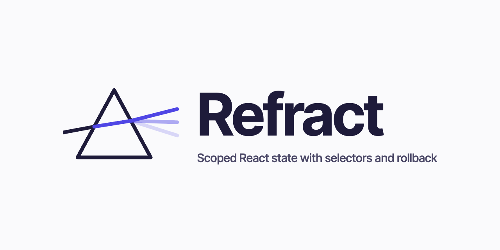

<p align="center">
  <picture>
    <source media="(prefers-color-scheme: dark)" srcset="https://raw.githubusercontent.com/khanglvm/refract/main/assets/banner-dark.png">
    
  </picture>
</p>

<p align="center">
  <a href="https://www.npmjs.com/package/refract-state"></a>
  <a href="https://github.com/khanglvm/refract/blob/main/LICENSE"></a>
</p>

<p align="center">
  <a href="https://refract.khangle.dev">Website</a> | <a href="https://docs.khangle.dev/refract">Docs</a>
</p>

Refract is a React state library for state that several components of one feature share, such as a form, an editor or a page's filters. `createContextState<State>()` gives you a Provider, the component that holds the state, and hooks typed to `State`. Each Provider you render owns its own store. Components read it through selectors, functions that pick the part of the state they need, and rerender only when that part changes. Updates are a partial object or an Immer draft, a copy of the state you change in place while Immer builds the next state from it. Every update returns a function that undoes it.

## Install

```sh
npm i refract-state
```

Refract needs React 18 or 19, and Immer is its only dependency.

## Example

```tsx
'use client' // only needed in the Next.js App Router

import { createContextState } from 'refract-state'

const counter = createContextState<{ count: number }>()

function Count() {
  const count = counter.useContextStateValue(state => state.count)
  return <p>Count: {count}</p>
}

function AddOne() {
  const setState = counter.useSetContextState()
  return <button onClick={() => setState(draft => { draft.count += 1 })}>Add one</button>
}

export default function App() {
  return (
    <counter.Provider initialState={{ count: 0 }}>
      <Count />
      <AddOne />
    </counter.Provider>
  )
}
```

Clicking the button rerenders `Count`, which selects `state.count`. `AddOne` only gets the setter, so it does not subscribe and the store never rerenders it.

## Why Refract

- Where you place the Provider decides who shares the state: the whole app, one route, or each card in a list.
- Selector results are compared by value, so a selector can return a new object.
- Each update returns `revert`, so you can show a change before the server confirms it and undo it if the request fails.
- During server rendering each Provider creates its own store, so two requests never share state. Every module ships with `'use client'` for the Next.js App Router.
- A snapshot getter reads the current state inside async handlers without subscribing the component.

## Docs

- [Quick start](https://docs.khangle.dev/refract/quickstart): the counter, then a store module to copy.
- [Read with selectors](https://docs.khangle.dev/refract/selectors) and [Update state](https://docs.khangle.dev/refract/updates).
- [Optimistic updates with revert](https://docs.khangle.dev/refract/rollback)
- [Next.js App Router](https://docs.khangle.dev/refract/nextjs)
- [API reference](https://docs.khangle.dev/refract/api) and [How it works](https://docs.khangle.dev/refract/how-it-works), for the costs and edge cases.
- For coding agents: [Refract for coding agents](https://docs.khangle.dev/refract/agents) and [llms.txt](https://github.com/khanglvm/refract/blob/main/llms.txt), a plain-text index of the docs. The package also ships both under `node_modules/refract-state/`, matching the installed version.

Refract was extracted from [@khanglvm/react](https://github.com/khanglvm/react), whose `createContextState` now comes from this package. To move code over, change the import to `from 'refract-state'`.

## Develop

```sh
npm ci
npm test
npm run build && npm run test:package
```

`npm test` runs the unit tests. `test:package` imports the built package by name, renders it on the server and checks that every built module starts with `'use client'`.

To release, bump `version` in `package.json` on `main` and add its entry to `CHANGELOG.md`. CI then publishes that version with npm trusted publishing: npm accepts the package from this repository's GitHub workflow, so the repository stores no npm token.

## License

MIT. See [LICENSE](https://github.com/khanglvm/refract/blob/main/LICENSE).
